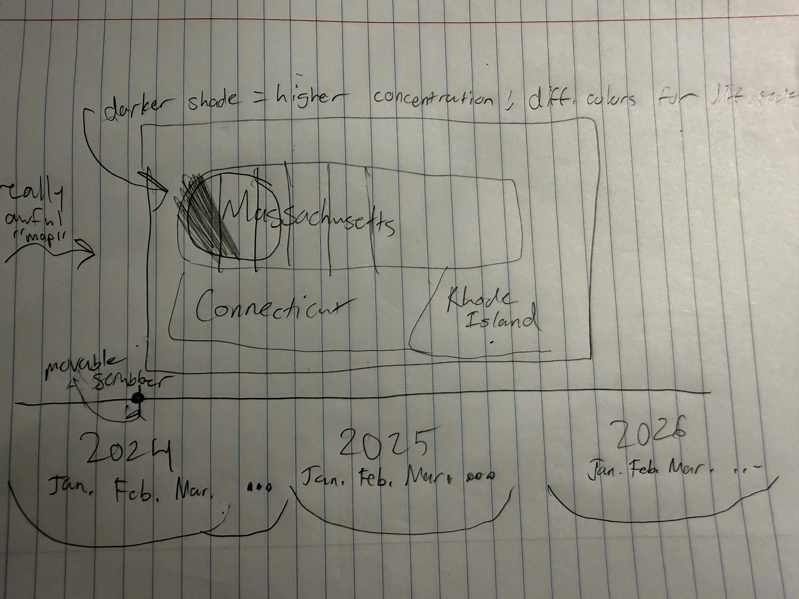
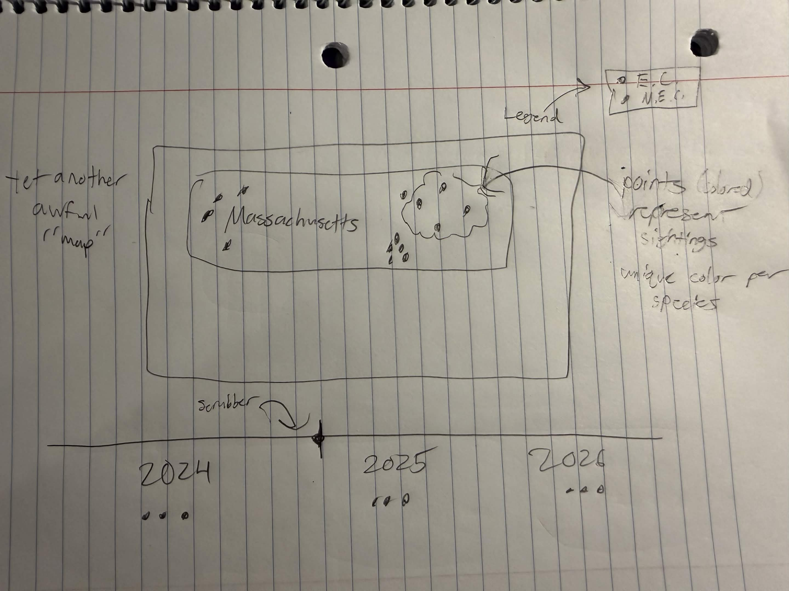
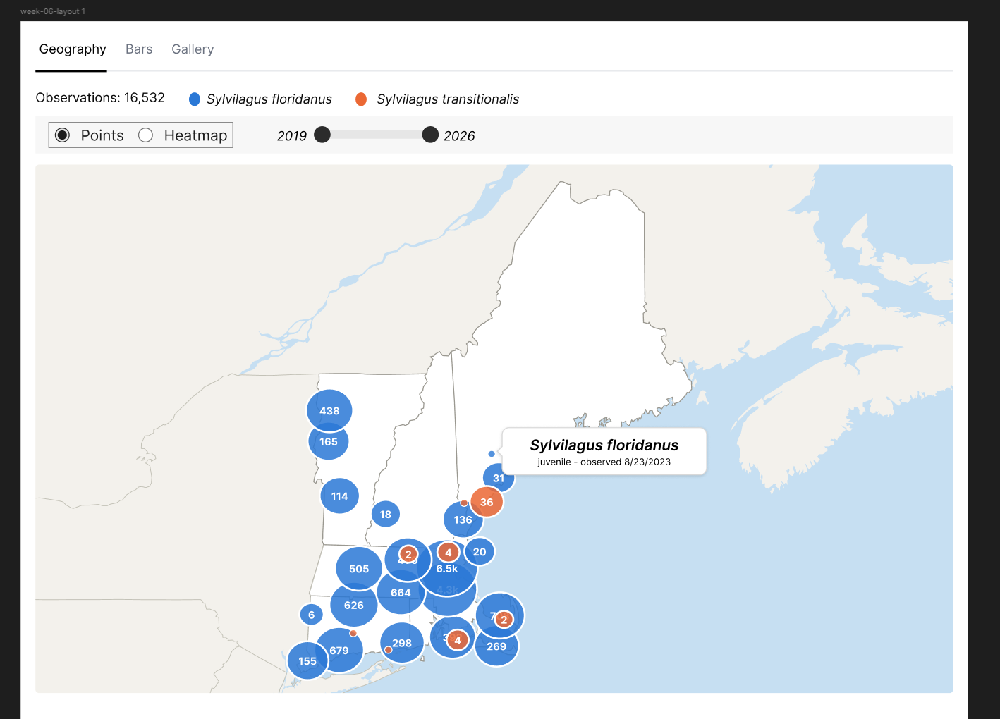
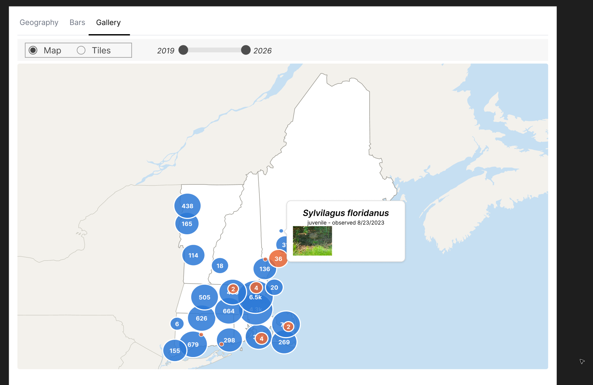

# Final Project - Updated Ideas

_This is a shorter version of [FINAL_PROJECT_EXPLORATION_1](FINAL_PROJECT_EXPLORATION_1.md)._

## Topic
I am interested in exploring the population distributions and activity patterns of cottontail rabbits in the New England region. A while ago, I learned about the vulnerable "New England cottontail" (_Sylvilagus transitionalis_), and efforts to restore its population by creating new habitats. I'm hoping to learn more about where they've actually been observed in the years since those efforts have started.

## Potential Questions
- How dramatic is the difference between the Eastern cottontail population and the New England cottontail population?
- How have the populations changed over time?
- Are there visible signs of the New England cottontail population recovering?
- When and where are cottontails most frequently seen?
- How often are mature cottontails seen, as opposed to young ones?

## Datasets

I'm currently using a filtered dataset of iNaturalist data exported from GBIF.

## Related projects

iNaturalist as a whole is research-oriented and provides great visualization tools for people who are interested in wildlife. More specific to cottontails, though, the University of New Hampshire operates a project called [NH Rabbit Reports](https://www.nhrabbitreports.org/), which solicits reports of rabbit and hare sightings from New Hampshire residents.

## Sketches

### Sketch 1

The rough idea here is to have a heatmap of observations of the different species, all throughout New England and across a period of multiple years. Obviously I would use a real embedded map and not some hand-drawn garbage :-)

The progression through time would be implemented with a timeline scrubber, pretty much like a video. I haven't yet figured out how I'd want to represent change over larger periods of time.

### Sketch 2

This is more inspired by the NH Rabbit Reports project. It's a similar concept to the one in Sketch 1, except instead of aggregating observations into a heat map, I would display them as individual points (or clusters) on the map.

### New Sketches

I used Figma to mock up some additions to the current UI.

My first concept involves adding two options: the ability to render observations as points or a heatmap, and the ability to filter by time range. I also want the map points to have tooltips with some more information about the corresponding observation.

I've also added a concept of a "gallery" tab that's intended for more casual browsing.

